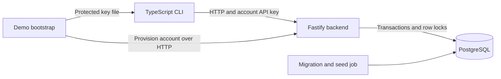

# Usage Metering and Quota Service

A Boot.dev final project in TypeScript, Fastify and PostgreSQL. It answers:
**Can this user consume these units without exceeding either the company's quota or their own?**

The service records the decision, charges both counters together when allowed,
and safely replays retries. The emphasis is correctness under concurrent requests,
account isolation and an understandable implementation: one backend and one database.

## Features

- Account provisioning, one API key per account, and multiple users per account.
- Predefined and account-owned custom plans at account and user levels.
- Monthly allowances and per-request limits enforced at both levels.
- Atomic consumption, zero-charge rejections and durable request decisions.
- Account-scoped idempotency: exact retry replays; changed parameters return 409.
- UTC calendar months, preserved historical usage and plan changes without resets.
- Current usage, monthly history and cursor-paginated decision history.
- A real HTTP CLI demo, isolated regression/concurrency tests and measured benchmarks.

There is no billing, refund system, end-user login or distributed infrastructure.

## Technology stack

Node.js 22+, TypeScript, Fastify, PostgreSQL 17, the `pg` SQL client,
`node-pg-migrate`, Docker Compose, Vitest and Node's built-in test runner.
The CLI is a separate TypeScript build using Node fetch.

## Architecture



PostgreSQL is the source of truth. The CLI displays decisions; it does not calculate
quotas or access the database. Compose runs migration/seed and bootstrap as one-shot
jobs around the two long-running services. See [architecture and transaction flow](docs/architecture.md)
and [database tables and constraints](docs/database-design.md).

## Quick start

Requirements: Docker Engine with the Compose plugin, Node.js 22+ and npm for local
build/tests, and a POSIX shell (Linux/WSL2 examples). No host PostgreSQL is required.
Open the repository root and create a private `.env` **only for a new checkout**:

```sh
node --input-type=module <<'JS'
import { readFileSync, writeFileSync } from 'node:fs';
import { randomBytes } from 'node:crypto';
const text = readFileSync('.env.example', 'utf8')
  .replace(/^POSTGRES_PASSWORD=.*$/m, `POSTGRES_PASSWORD=${randomBytes(32).toString('hex')}`)
  .replace(/^PROVISIONING_TOKEN=.*$/m, `PROVISIONING_TOKEN=${randomBytes(32).toString('hex')}`);
writeFileSync('.env', text, { flag: 'wx', mode: 0o600 });
console.log('Created private .env; values were not printed.');
JS
```

The command refuses to overwrite an existing `.env`. Keep existing database
credentials when using an existing volume. [Configuration details](docs/setup.md)
explain every variable and the bootstrap secret handoff. Never commit `.env`.

Start the complete stack and first demo:

```sh
docker compose up --build -d
docker compose ps -a
docker compose logs demo-bootstrap example-client
```

`postgres` and `backend` stay running; `migrate`, `demo-bootstrap` and
`example-client` should exit 0. The default API URL is `http://localhost:3000`;
PostgreSQL has no published host port. Health checks:

```sh
curl -fsS http://localhost:3000/health
curl -fsS http://localhost:3000/ready
```

The demo creates Ahmad on Basic and Sara on Premium, shows user- and account-level
rejections, switches the account plan through the API and retries an accepted
request. Final usage is **45 account units, 10 Ahmad units and 35 Sara units**;
five original decisions are stored. See [the complete CLI walkthrough](docs/example-client.md).

To rerun with a fresh account, remove only the completed demo containers:

```sh
docker compose rm -f demo-bootstrap example-client
docker compose up -d example-client
docker compose logs demo-bootstrap example-client
```

Prior demo accounts remain as history. To stop without deleting data, run
`docker compose stop`. Never use `docker compose down -v` for routine cleanup;
`postgres_data` holds the application database and `demo_api_key` holds the demo
key handoff. `npm run demo:cleanup-secret` clears only the demo key files.

## API and domain rules

Protected endpoints use `x-api-key`. Account creation instead requires the
administrator's `x-provisioning-token`; the CLI never receives that token.
Only the account API-key hash is stored in PostgreSQL. There is no implemented
key rotation/revocation endpoint. All account-specific queries use the authenticated
account; a foreign user's UUID cannot select another account's data.

A new account starts on Starter; each new user starts on Basic. The same user-plan
definition may serve many users while each retains an independent allowance.
[Predefined plan limits](docs/predefined-plans.md) are project assumptions.
Custom definitions belong to one account; predefined definitions are read-only through the API.

Consumption locks the account first, then the user and monthly counters. Both
levels must allow the request. Accepted counter changes and history commit in
one transaction; quota rejections save history without charging. The request ID
is unique per account. Exact retries return the stored status/body with
`Idempotency-Replayed: true`, including an original rejection.

New UTC months use new counter rows; no scheduled reset deletes prior usage.
Plan changes affect subsequent new decisions without erasing usage. Remaining
allowance is clamped to zero if the new limit is below consumption already used.
Usage/history amounts are decimal strings to preserve BIGINT precision.

The [API reference](docs/api-reference.md) documents all 20 route templates,
request/response examples, error behavior and both history cursor formats.

## Build, tests and performance

From the repository root:

```sh
npm ci
npm run build
npm test
```

[Testing instructions](docs/testing.md) explain `test:db:isolated`,
`test:client:integration` and `test:compose:demo`, their prerequisites and their
side effects. Raw `test:db` must never target a populated application database.
Phase 8A runs only build/unit/offline validation; the database/Docker tests are
separately documented, not rerun as documentation verification.

The validated [performance report](performance/final-report.md) covers 112 saved
runs, **77,668 measured requests plus 5,600 warmups**, and no unexpected HTTP,
transport or timeout failures in those runs. With one account/user on tmpfs,
concurrency 1/50 measured 123.53/154.15 req/s, while P95 grew from 13.00 to 397.46 ms.
At concurrency 50, one/ten-account rates were 149.96/102.12 on tmpfs and
71.81/100.09 on disk. These are medians of three trials, not production capacity claims.

P50/P95/P99 describe the latency at or below which 50/95/99% of trial samples fall.
The pool remained 10 clients; sampled lock waits, pool queues, CPU throttling and
WAL synchronization help explain why removing one shared lock does not guarantee
higher throughput. tmpfs avoids persistent-disk costs; disk results still include
caches and virtualization. Sustained workloads lasted about 60 seconds.
Saved audits matched counters/history and rejected/replayed charge rules for tested cases.

```sh
npm run perf:validate
# Deliberate new measurements; save existing results before either command:
npm run perf:baseline
npm run perf:analysis
```

`perf:validate` is offline and regenerates validation/final-report outputs.
Benchmark commands create isolated Docker stacks and overwrite their own prior
result files. Requirements, resource limits, cleanup and evidence limits are in
the [performance report](performance/final-report.md); they do not benchmark the main database.

## Repository guide

| Path | Purpose |
|---|---|
| `src/app.ts`, `src/server.ts` | Fastify setup, safe errors, health and HTTP startup |
| `src/routes/`, `src/plugins/` | API handlers and account API-key authentication |
| `src/db/`, `migrations/` | Connection pool, predefined plans and versioned schema |
| `client/src/` | TypeScript HTTP client, configuration and business-action demo |
| `scripts/`, `tests/` | Bootstrap, integration/concurrency/recovery and unit tests |
| `scripts/perf/`, `performance/` | Benchmark/validation tools and actual results |
| `Dockerfile`, `compose.yaml` | Images, startup dependencies and persistent volumes |
| `docs/` | [Setup](docs/setup.md), [architecture](docs/architecture.md), [API](docs/api-reference.md), [database](docs/database-design.md), [testing](docs/testing.md) and audits |

## Scope and remaining limits

The [requirements status](docs/requirements-status.md) separates implementation,
executed evidence and unresolved items. The supplied official Boot.dev specification
has been reviewed; no missing mandatory core feature was identified. Public GitHub
delivery and submission completion remain unverified.
The [Phase 6 acceptance](docs/phase-6c-acceptance.md) is historical, bounded evidence.

No production SLA, long-term endurance or disk crash-recovery guarantee is claimed.
The service has no built-in TLS, rate limiting, API-key lifecycle API or production
deployment automation. Single-account traffic intentionally serializes for correctness.
GitHub publication and final delivery verification remain separate from this documentation review.
