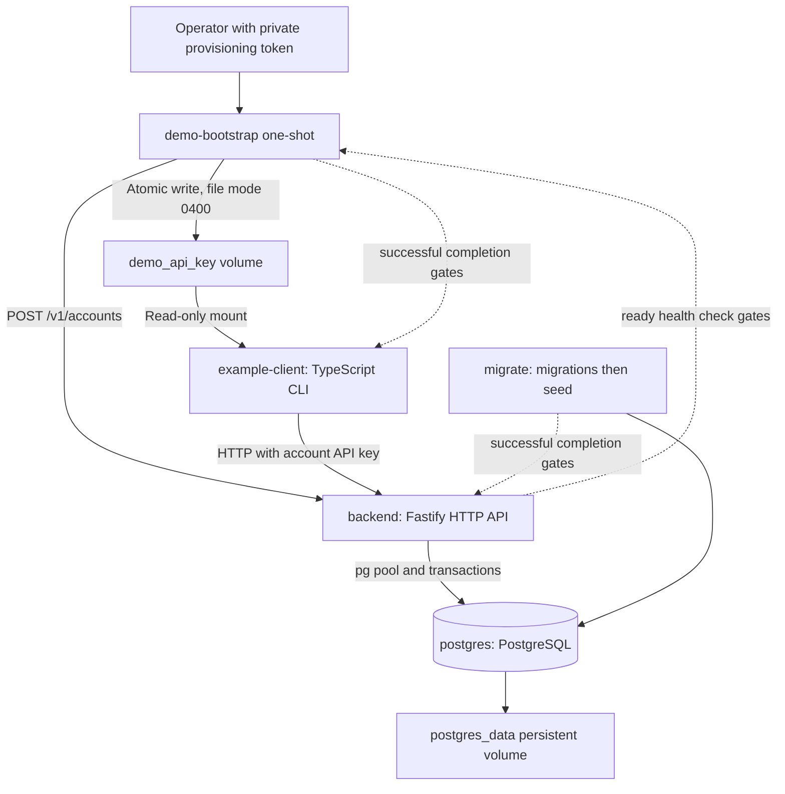
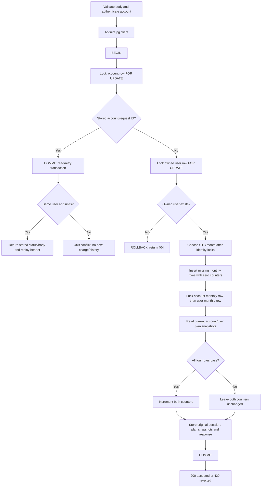

# Architecture and transaction design

This project models one resource measured in positive integer units. An account
is a company/application; a user is an account-owned consumer, not a login identity.
A plan definition supplies a monthly allowance and maximum units per request.
The same plan can be shared, but usage belongs to each account/user/month.

## Components and startup

The two long-running services are `backend` and `postgres`. `migrate` waits for
healthy PostgreSQL and applies versioned SQL before seeding. `backend` waits for
successful migration/seed. `demo-bootstrap` provisions through HTTP only after
readiness; the CLI runs only after bootstrap succeeds. Bootstrap and CLI do not
run migrations or access PostgreSQL. The only published port is the backend API.
See [setup](setup.md) for runtime settings and volume handling.

Fastify validates JSON and route parameters. The `pg` pool defaults to ten clients,
5000-ms connection acquisition timeout and 30000-ms idle timeout. Pool acquisition
can queue before a request has a database connection. The CLI uses HTTP and checks
returned decisions/allowances; it cannot authorize consumption on its own.

## Authentication and isolation

`POST /v1/accounts` requires a provisioning token of at least 32 characters,
configured on the backend. The presented/expected tokens are hashed and compared
with `timingSafeEqual`. Missing/short server configuration returns 503, not open
registration. Demo bootstrap receives this privileged token; the CLI does not.

An account API key is 32 random bytes encoded as base64url. The raw key is returned
only on successful provisioning. PostgreSQL stores a unique SHA-256 hash. Protected
routes hash `x-api-key`, look up the account and attach its ID to the request.
There is no key recovery/rotation/revocation endpoint. Losing the raw key cannot
be repaired by reading its hash. Production key management would require separately reviewed work.

Queries bind the authenticated account ID, never an account ID supplied by a
consumer. User lookup includes both UUID and account; unknown and foreign users
return 404 on relevant endpoints. Custom plans require the same owner account;
predefined plans have no owner and are readable/assignable by all accounts.
Foreign-key/ownership triggers provide a second layer beneath API checks.
This is application-level tenant isolation with database constraints, not PostgreSQL row-level security.

## Consumption transaction

Both account and user limits must permit the entire request. A transaction groups
related SQL changes so they either commit together or roll back together. Row
locks make concurrent transactions wait before observing/updating shared usage.
The implementation uses PostgreSQL's default transaction isolation, with explicit
`FOR UPDATE` locks; current-usage reports instead use read-only repeatable-read transactions.

The diagram shows the normal decision paths. A missing account after authentication
rolls back with 401. SQL/connection failures attempt rollback; a client that cannot
roll back is discarded. Infrastructure errors do not become durable quota rejections.
A committed request whose HTTP response is lost must be retried with the same ID:
the stored outcome resolves whether the charge already happened.

The exact new-request lock order is account identity, user identity, account monthly
usage, user monthly usage. The request-history lookup happens **after the account
lock and before user lookup or month selection**. Consequently an exact retry
preserves the original decision/month/limits rather than evaluating current plans.
Plan values are read after the locks; consumption does not add a separate plan-row lock.

Why account first? Every new charge affects shared account usage, including charges
from different users. Account-first locking serializes them and coordinates plan
assignments/owned-plan mutations with consumption. Those mutations lock the owning
account first too; user assignment additionally locks the user before updating it.
This convention avoids the tested overspending races and reduces deadlock opportunities;
it is not a proof that every possible external SQL operation can never deadlock.

A valid new request checks account and user per-request maxima and monthly allowances.
All failed rules are returned in account-per-request, user-per-request,
account-monthly, user-monthly order. Acceptance increments both counters by the same
units; rejection increments neither. Both outcomes persist exactly one original
history row, with all plan limits and the response body, before COMMIT.
Schema/ownership failures and conflicting request IDs do not create new quota-history entries.
A rejected first request may create zero-valued month rows; zero charging does not
mean no database writes.

## Idempotency, months and plan changes

The database unique key is `(account_id, request_id)`. Same ID in another account
is independent. For an existing ID, same normalized user UUID and numeric units
return the stored 200/429 body with `Idempotency-Replayed: true`; different user
or units produce 409. Request IDs are case-sensitive and retained exactly as
supplied (blank-only strings are rejected). Rejection retries remain rejections
after a later plan upgrade; use a new ID for a genuinely new business attempt.

The new-request processing month is computed by PostgreSQL's `clock_timestamp()`
in UTC **after both identity locks are held**. It is stored as the first date of
the month. Waiting across midnight/month-end can therefore assign a new request
to the later month. Clients cannot backdate requests. A new month starts at zero
by selecting/creating different month rows; no reset job erases prior rows.

Changing an assignment or editing an owned shared plan affects subsequent new
requests, without resetting existing usage or rewriting history. Editing a shared
user-plan definition affects every assigned user, while their counters stay separate.
Remaining allowance is `max(allowance - used, 0)`; a downgrade below used units
blocks further positive consumption until allowance or month permits it.

## Reporting and trade-offs

Current usage reads month, current plan and usage inside one read-only repeatable-read
transaction, so its response uses a coherent snapshot. Missing current counters
are reported as zero without inserting rows. Historical month reports return only
stored rows, not fabricated zero rows for every unused month. Decision history
returns applied plan snapshots, which may differ from current plan details.
See [API pagination](api-reference.md#pagination) for the two cursor contracts.

Account serialization deliberately favors correctness and a clear explanation over
maximum same-account throughput. Independent accounts can progress separately but
still share pool/CPU/WAL resources. [Measured results](../performance/final-report.md)
show both lock and pool queues; they do not justify removing locks or increasing
the pool without further controlled tests.

## Important source files

| File | Responsibility |
|---|---|
| `src/app.ts` | App creation, validation settings, safe errors, health/readiness, route registration |
| `src/server.ts` | Listen on configured port |
| `src/plugins/api-key-auth.ts` | Derive authenticated account from key hash |
| `src/routes/consumptions.ts` | Transaction, locks, quotas, snapshots and idempotency |
| `src/routes/plan-assignments.ts`, `plans.ts` | Scoped plan assignment/management |
| `src/routes/usage.ts`, `requests.ts` | Current/monthly usage and decision history |
| `src/db/pool.ts`, `seed.ts` | Shared pool and immutable default catalog checks |
| `client/src/` | HTTP transport, private key configuration and demo assertions |

No billing, end-user authentication, multiple resources or distributed coordination
is implemented. Operational limits, including key lifecycle and graceful shutdown
coverage, are recorded in [requirements status](requirements-status.md).
