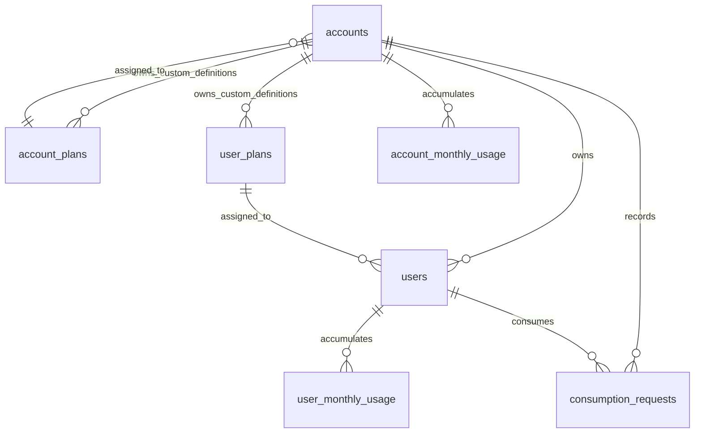

# Database design

PostgreSQL holds identities, plans, monthly counters and original request outcomes.
The backend uses parameterized SQL through `pg`, not an ORM. UUIDs use
`gen_random_uuid()`. All seven domain tables have explicit keys/constraints;
`pgmigrations` is migration-runner bookkeeping rather than a domain table.

## Relationships

The diagram expresses logical ownership/assignment. Predefined plans have no owner;
custom plans have one owner. Composite keys/triggers, described below, enforce
which assignments and user/account pairs are legal. Plan IDs stored in request
history are snapshots, not foreign-key relationships to the live definitions.

## Tables and actual columns

| Table | Columns | Purpose and keys |
|---|---|---|
| `accounts` | `id`, `name`, `api_key_hash`, `created_at`, `account_plan_id`, `account_plan_owner_account_id` | Company/application identity; UUID PK; unique API-key hash; required account plan |
| `users` | `id`, `account_id`, `name`, `user_plan_id`, `user_plan_owner_account_id`, `created_at` | Consumer owned by an account; UUID PK; account FK; required user plan; unique `(id, account_id)` |
| `account_plans` | `id`, `owner_account_id`, `name`, `monthly_allowance`, `max_units_per_request`, `is_predefined`, `created_at` | Account-level plan definitions; UUID PK; optional owner account FK |
| `user_plans` | `id`, `owner_account_id`, `name`, `monthly_allowance`, `max_units_per_request`, `is_predefined`, `created_at` | User-level plan definitions; UUID PK; optional owner account FK |
| `account_monthly_usage` | `account_id`, `month`, `used_units`, `created_at`, `updated_at` | One aggregate counter per account/UTC month; PK `(account_id, month)`; account FK |
| `user_monthly_usage` | `account_id`, `user_id`, `month`, `used_units`, `created_at`, `updated_at` | Independent counter per user/UTC month; PK `(account_id, user_id, month)`; composite user/account FK |
| `consumption_requests` | Listed below | Original accepted/rejected decisions, idempotency and applied snapshots |

`consumption_requests` columns:

| Group | Columns |
|---|---|
| Identity/input | `id`, `account_id`, `request_id`, `user_id`, `units`, `created_at` |
| Outcome | `status`, `rejection_reasons`, `failed_rule_levels` |
| Account snapshot | `account_plan_id`, `account_plan_name`, `account_monthly_allowance`, `account_max_units_per_request` |
| User snapshot | `user_plan_id`, `user_plan_name`, `user_monthly_allowance`, `user_max_units_per_request` |
| Replay | `response_status`, `response_body` |

Its PK is UUID `id`; `UNIQUE (account_id, request_id)` is the idempotency constraint.
`request_id` is text, not necessarily a UUID. The user/account composite FK requires
that the user belongs to the stored account. `response_body` is a JSONB object;
`rejection_reasons` is a JSONB array; `failed_rule_levels` is an array limited to
`account`/`user`. Accepted outcomes require empty rejection details; rejected ones
require nonempty reasons/levels. Status must agree with a success/error HTTP class.
The application stores 200 for acceptance and 429 for quota rejection.

There is no dedicated `usage_month` column on `consumption_requests`: the applied
month is inside `response_body.usage_month`. It must not be confused with the
history timestamp: its default is PostgreSQL `now()` at transaction start, while
month selection occurs after identity locks. Waiting across a month boundary can
therefore give different months in `created_at` and `response_body.usage_month`.
The response JSON also retains the original account/user used/remaining amounts.

## Ownership and assignment constraints

Plan tables require either `(owner_account_id IS NULL AND is_predefined)` or
`(owner_account_id IS NOT NULL AND NOT is_predefined)`. Each has a partial unique
index for predefined `name` and another for custom `(owner_account_id, name)`.
The two scopes use separate tables, so their names/IDs are not interchangeable.
`UNIQUE (id, owner_account_id)` supports composite assignment foreign keys.

Every account and user has a non-null plan ID after all migrations. Live plan IDs
reference the corresponding plan table with `ON DELETE RESTRICT`. The auxiliary
`account_plan_owner_account_id`/`user_plan_owner_account_id` columns are NULL for
predefined assignments and equal the authenticated/owning account for custom ones.
Composite FKs and owner checks protect custom assignments. Separate single-column
plan FKs remain necessary when the auxiliary owner is NULL.

Triggers validate ownership on insertion and explicit owner/account updates, and
synchronize owner metadata when the plan ID changes. Ownership/predefined status
on plan definitions cannot change after creation. This supports shared global
predefined plans and account-owned shared user plans without allowing cross-account
custom assignments. API clients never set auxiliary owner columns.

`users.account_id` references accounts. The composite `(user_id, account_id)` FKs
in usage/history prevent a user from being paired with a different account.
Account-owned records have cascading deletion relationships in SQL, while live
plan assignment references restrict plan deletion. No public deletion endpoint
exposes these operations; tests remove only their own fixtures where documented.

## Values, month keys and history

- Account/user names: trimmed nonblank length 1–200; plan names 1–100.
- API-key hash: 64 lowercase hexadecimal characters, unique. Raw keys are not stored.
- Monthly allowances/counters: BIGINT, 0–9,000,000,000,000,000.
- Request maxima/request units: bounded to 1–1,000,000.
- Monthly dates must be the first date of a calendar month; application SQL chooses UTC.
- Each counter defaults to zero; timestamps use `TIMESTAMPTZ`, monthly keys use `DATE`.

JavaScript `BigInt` performs quota arithmetic. The API serializes BIGINT quantities
as decimal strings to avoid rounding and JSON's inability to encode BigInt directly.
Input limits remain bounded exact JSON integers. Consumption response `units` is a
number; request-history `units` is a string. See [API conventions](api-reference.md#conventions-and-authentication).

Counters are updated only after both account/user checks pass, in the same
transaction as the decision insert. Zero-charge rejections may initialize a
zero-valued month row. New months use different PKs, preserving all prior rows.
Plan changes do not delete counters. Request snapshots preserve applied names,
limits and original response even if the current plan later changes. Snapshot
plan IDs intentionally have no live-plan FKs; snapshots are historical evidence.

Indexes support account/user lookup, plan assignment and descending decision history:
`(account_id, created_at DESC, id DESC)` and
`(account_id, user_id, created_at DESC, id DESC)`. Monthly tables' PKs support month
lookups; user usage additionally indexes `(user_id, month)`. These are implemented
indexes, not a claim of measured optimal query plans.

## Migrations, seed and persistence

Six ordered migrations under `migrations/` define the current schema:

1. `1735000000000_initial-schema.js`: tables, indexes, ownership checks/triggers.
2. `1735000000001_request-outcome-consistency.js`: accepted/rejected detail checks and comments.
3. `1735000000002_shared-predefined-plan-assignments.js`: shared predefined assignment support.
4. `1735000000003_immutable-plan-ownership.js`: immutable plan ownership/predefined scope.
5. `1735000000004_strict-plan-assignment-validation.js`: separate strict insert/update owner validation and plan-ID synchronization.
6. `1735000000005_required-plan-assignments.js`: required account/user plan IDs.

Read migrations in order: the initial nullable/pair rules alone do not describe
the final schema. `scripts/migrate.mjs` uses node-pg-migrate's `pgmigrations` table,
a waiting advisory migration lock and a single transaction for pending migrations.
Repeated startup applies only unapplied migrations. Compose then runs `npm run seed`.
Seeding adds missing predefined definitions, leaves matching definitions/custom
plans intact and fails on predefined drift instead of overwriting it. See
[predefined values](predefined-plans.md).

Compose mounts `postgres_data` at `/var/lib/postgresql/data`; stopping/recreating
containers with that existing named volume retains rows and migration history.
PostgreSQL image initialization credentials apply when initializing a new data
directory, not as a password-rotation mechanism on an existing one. Do not remove
the volume to resolve configuration errors. No backups, production restore policy
or disk crash-recovery guarantee is established by this project documentation.
